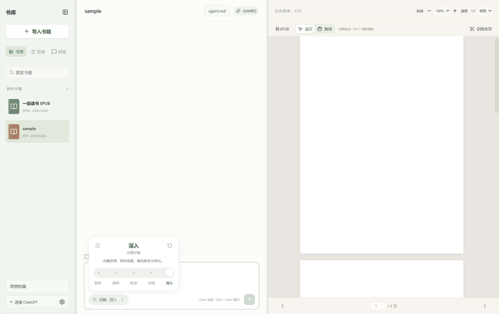
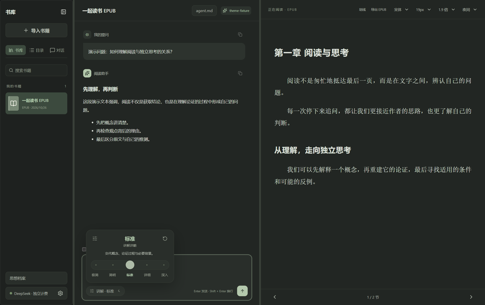
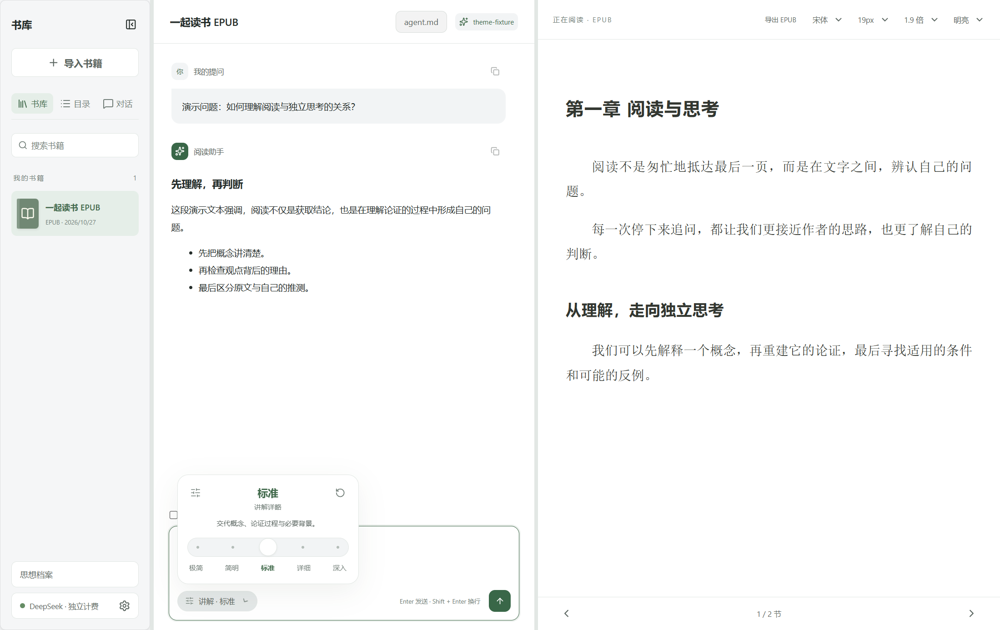

# AI 读书助手

一个 Windows 本地桌面读书工具，把 PDF / EPUB 阅读、原文引用和 AI 对话放在同一窗口。

它希望帮助读者理解一本书的概念、论证与局限，并把阅读中的独立思考持续记录下来。



> 截图使用自动化测试书籍，展示实际应用界面；未展示真实模型回答。当前版本：**0.5.11**，个人项目，持续迭代中。

## 功能

### 阅读与引用

- 三栏布局：书库 / 目录 / 历史会话、AI 对话、阅读器；分栏宽度可调整。
- 导入 PDF、EPUB，按书名搜索，恢复阅读位置与草稿。
- 鼠标拖选原文并复制粘贴到聊天框；手动粘贴保持普通文本，不猜测出处。
- PDF 缩放、适宽、页码跳转和拖动；EPUB 字体、字号、行距与阅读背景调整。
- 目录跟随当前章节高亮，显示章节字数；固定位置的前后翻页按钮。
- 扫描 PDF 可按需使用本地中英文 OCR；识别结果可选文、复制和引用。
- PDF 转为可重排的文字 EPUB，并支持导出。

### 对话与个性化

- 每本书独立的会话、消息、草稿和聊天上下文，支持多个历史会话。
- 流式回答、Markdown、复制、停止与失败重试；生成时保持聊天滚动位置。
- 发送输入文字、已有引用与本会话历史；发送即清空输入框，保留生成期间新写的草稿。已移除附加章节入口。
- 输入框底部提供五档**讲解详略**：极简、简明、标准、详细、深入。每本书独立记忆，重试沿用原问题档位。这控制讲解展开程度，不是模型推理强度。
- 每本书独立的 `agent.md`，可在软件内查看、编辑、恢复默认提示词；另有可编辑授课进度。
- 全局**长期思想档案**：手动记录，或从成功回答的附加数据中整理用户提出的观点。自动条目的用户原话必须匹配本次输入，AI 整理内容单列；删除书籍不会删除思想档案。

## 安装与使用

面向 **Windows x64**，无需安装 Node.js 或 Python。若仓库已发布 Release，请从 Releases 下载对应版本安装包；源码仓库本身不包含安装程序。

1. 运行 `AI读书助手 Setup 0.5.11.exe`，选择安装位置。
2. 导入自己的 PDF / EPUB。
3. 在连接设置中配置自己的 AI 账户，并选择可用模型。
4. 选中原文，Ctrl+C 复制，点击聊天框 Ctrl+V 粘贴，输入问题后发送。

`Enter` 发送，`Shift + Enter` 换行。升级前退出旧版应用。安装包不附带开发者的书籍、聊天、账号或 API Key。

**AI 连接：**项目实现了 ChatGPT 浏览器授权路径及 DeepSeek API Key 模式。ChatGPT 的实际账户资格、模型权限、套餐授权和网络可用性须由使用者真实登录验证；浏览器显示回调成功不等于套餐使用已获授权。DeepSeek API 独立计费，需自行提供 Key；不会因套餐额度不足自动切换计费方式。

**验证边界：**开发测试使用隔离身份与模拟模型传输，未据此声称真实账户授权或真实模型调用成功。阅读、OCR 和 PDF 转 EPUB 可在未连接 AI 时使用；AI 对话需要网络和有效连接。

## 本地数据与隐私

默认数据目录：

```text
%APPDATA%/reading-companion/
├── library.sqlite        # 书库、会话、草稿、思想记录等
├── books/                # 导入书籍的应用内副本
├── book-agents/<书籍ID>/
│   ├── agent.md          # 本书提示词
│   └── progress.md       # 授课进度镜像
├── thought-archive/
│   └── 思想档案.md       # 全局档案镜像
└── credentials.enc       # Windows 当前用户保护的凭据
```

- 书籍导入后复制到应用数据目录；删除应用内书籍不删除来源文件。
- 凭据由 Electron 主进程加密管理，不向界面提供原始令牌。
- 只有主动发送问题时才调用模型；问题、引用、可选章节、当前会话历史，以及提示词、进度和最近思想标题索引会作为上下文发送至所选服务。
- 思想档案及进度 Markdown 是数据库生成的镜像，请在软件内编辑；`agent.md` 支持外部编辑，下次请求读取。
- 备份请先退出应用，再复制整个数据目录。加密凭据依赖 Windows 用户环境，不保证跨设备恢复登录。

## 开发

建议使用 Windows 和 Node.js 24，依赖版本锁定于 `package-lock.json`。

```powershell
npm ci
npm start
```

若 Electron 二进制未正确安装，可运行 `node node_modules/electron/install.js` 后重试。依赖安装与首次构建工具准备需要网络。

```powershell
npm run build          # 类型检查与前后端构建
npm test               # 单元测试
npm run test:desktop   # 隔离数据目录的桌面集成测试
npm run test:detail    # 五档控件、键盘、跨书隔离、重启恢复
npm run test:knowledge # 提示词、进度和思想档案
npm run test:chat-scroll
npm run package        # Windows x64 NSIS 安装程序，输出至 release/
npm run test:packaged  # 验证打包后的应用
```

其他阅读器、OCR、转换、划线移除兼容与导航测试见 `package.json`，实际验证记录见 [VALIDATION.md](VALIDATION.md)。测试采用临时独立数据目录，不使用个人书库。

## 架构

| 层   | 技术与职责                                                                   |
| ---- | ---------------------------------------------------------------------------- |
| 界面 | React、TypeScript、Vite                                                      |
| 桌面 | Electron，受限 preload IPC，关闭渲染进程 Node 权限                           |
| 阅读 | PDF.js；epub.js 解析与 CFI，自定义安全 iframe 呈现 EPUB                      |
| 数据 | sql.js / SQLite、书籍文件副本、Markdown 镜像                                 |
| 识别 | Tesseract.js，安装包内置中英文识别数据                                       |
| 模型 | 主进程处理认证、网络与流式输出；ChatGPT Responses、DeepSeek Chat Completions |

```text
src/          界面、阅读器、排版与共享类型
electron/     文件、数据库、认证、聊天、OCR、思想档案
scripts/      构建资源准备
tests/        单元与桌面集成测试
docs/         项目说明与截图
```

## 当前限制

- 仅交付 Windows x64；未提供 macOS、Linux 或手机应用。微信分享包供好友在 Windows 电脑下载使用，不能在微信内直接运行。
- 不支持 DRM 书籍；OCR 可能识别错字、公式或表格。
- PDF 转 EPUB 为文字转换，不保留原始版式、图片或复杂表格。
- EPUB 可重排，不虚构固定页码；PDF 保证单页内选文，跨页选择不作为保证。
- EPUB 默认隐藏有明确语义标记的脚注和尾注，外部资源与书籍脚本被阻止。
- 没有整本书检索问答、云同步、语音、自动更新或手机端。
- AI 输出、自动进度与思想整理需要核对；原话匹配并不证明观点原创或正确。
- 安装包未做商业代码签名，Windows 可能显示发布者未知。

## 项目状态与反馈

欢迎通过 Issues 提交可复现问题或功能建议。请说明应用版本、Windows 版本、操作步骤与预期结果；不要上传 API Key、登录凭据、个人聊天或无权分享的整本书。

项目暂未声明开源许可证。源码可见不代表已授予任意复制、修改或再分发许可；第三方依赖遵循各自许可证。

## 0.5.1 · 全局主题

右上角‘界面主题’或设置中的同名入口，可切换纸色、明亮和夜间。主题同步应用到书库、聊天、输入框、阅读区、弹窗、思想档案与提示词编辑器，Windows 原生控件和标题栏跟随明暗偏好；重启恢复。夜间使用低亮度灰绿底色和柔和浅色文字，明亮使用白色与中性浅灰层次。PDF 原始页面和书内图片保持原色，以保留图表颜色含义。验证命令：npm run test:themes。

### 全局主题预览

夜间与明亮模式均覆盖整个应用。以下画面使用测试书籍和模拟回答，仅用于展示界面。





## 0.5.2 · 取消应用上下文上限

取消应用自行设置的 100,000 字符限制，以及 PDF 附加范围的字符数与 151 页限制。完整发送当前会话历史、提示词、进度和用户选择的原文，不自动摘要、截断或删除本地历史。模型服务自身的上下文窗口、请求大小与额度限制仍然适用。服务端拒绝时显示实际错误并保留问题和引用；可减少范围或新建本书会话后再试。长原文提取、网络传输与生成可能耗时更久。

验证：npm run test:context，覆盖 160 页、约 23 万字符 PDF 的完整提取和发送；单元测试覆盖两种模型通道的大上下文请求及服务端超限后保留、重试。

## 0.5.3 · 简化选文界面

移除划线功能及选文后浮动操作栏。PDF、EPUB 和 OCR 保留原生选文、Ctrl+C / Ctrl+V；章节附加、OCR 面板引用和已有消息来源定位保留。旧划线记录不主动删除，但不再显示。本版没有修改讲解提示词。

## 0.5.4 · 先讲清内容的讲解规则

默认将读者视为尚未阅读原文：先交代人物、事件和概念本身，再解释推论与联系。使用陈述式标题，避免悬空设问、先评论作者编排、用“原文介绍了”代替实际内容。五档均保留必要前提；用户明确询问结构时仍直接分析结构。来源用于核对，不替代讲解。未提供原文时明确说明，不凭目录猜内容。

统一规则每次请求自动附加，既有书籍和会话从下一次发送起生效，不覆盖各书 agent.md、授课进度或已有回答。可查看 [讲解规则与验收示例](docs/讲解规则与验收示例.md)。

## 0.5.5 · 连贯叙事与平实标题

重写可编辑的[默认读书提示词](docs/默认读书提示词.md)：普通讲课不提前总结后文，不用指向段落与写作过程的套话，标题直接说明对象和事项。人物先出场再评价，多个必要术语集中短列后接回主线。默认模板与每次请求共用表达约束。

仅自动升级与已知旧模板完全一致的 agent.md（兼容换行和 BOM 差异），保留用户编辑过的提示词及阅读进度；已有回答不改写。安装旧版的用户需升级程序才能获得新的统一规则。测试验证规则被实际发送，不代表真实模型输出已经达到预期；讲述效果仍需实际阅读检验。

## 0.5.6 · 按内容讲述与等长聊天滑块

叙事跟随人物与事件，理论沿具体问题、例子和论证展开，混合内容按段落需要自然衔接。五档详略不再强制使用授课框架；问题标题与术语说明按理解需要采用，保留忠实与来源边界。未修改的 0.5.5 默认提示词可自动升级，个性化内容保持原样。

聊天历史滑块固定为96像素，不随会话增长而缩短（窗口可用高度不足时适配），轨道宽16像素。支持拖动、轨道定位、滚轮与方向键、PageUp/PageDown、Home/End；生成保持阅读位置。无溢出时隐藏，适配纸色、白色和深色主题。

## 0.5.11 · 阅读与聊天交互更新

- EPUB 自动智能分段开关移入设置并持久保存；进入章节自动分析，按内容和2000–6000字参考范围建议边界，提供段号、字数与整段复制，复制不选中正文。结果本地缓存。PDF 不分段。首次分析会发送章节内容并使用当前模型额度。
- PDF、EPUB 和聊天正文选文后右键复制；输入框提供原生右键剪切、复制、粘贴、全选。
- 聊天栏可选六种字体，支持预览、即时切换与保存；聊天滑块固定长度，生成保持阅读位置。
- 默认提示词按叙事、理论、混合内容采用不同讲法；未修改的旧默认模板安全升级，个性化提示词不覆盖。
- 删除输入框字数、快捷键说明与附加章节入口。

验证：29项单元测试，以及打包程序的粘贴、字体保存、分段缓存、复制与稳定滚动交互。AI分段语义质量和实际讲述自然度仍需真实模型人工评测，模拟响应测试只验证集成。
